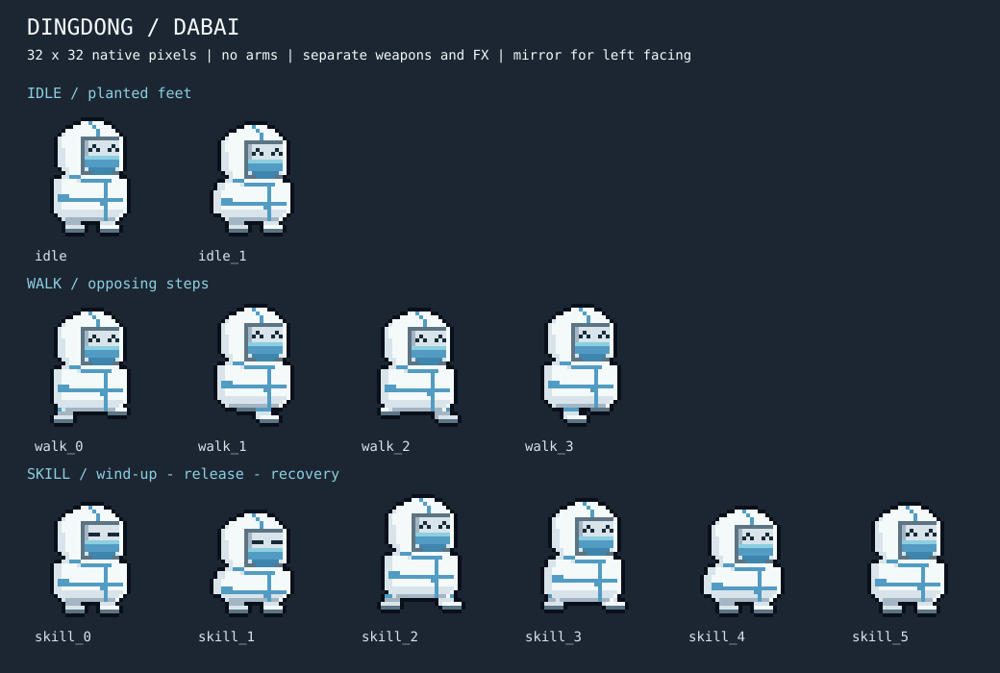

# 大白「叮咚鸡」

入口：转生泉的 **MEMES / 梗角色** 系列。新存档与旧存档均默认解锁，默认武器为现有的 Ding-Dong Repeater。原 CMYS 三形态保持独立；合集列表显示三个卡片并随选择滚动，第四个合集不会挤出 320px 视口。



## 美术与动画

- 原生 32×32 字符网格、八色调色板，由现有 `SpriteRenderer` 绘制并添加外轮廓。
- 完全不绘制手臂、袖筒和手套。头顶蓝条为防护服压胶条，没有鸡冠。
- 2 帧呼吸待机、4 帧行走、6 帧技能。待机双脚固定在同一基准；行走保留腿部交替；左向沿用水平翻转。
- 参考所提供视频的呼吸、脚步和下蹲变化，在统一网格上重画。行走参考约 3.00 / 3.25 / 3.50 / 3.75 秒，技能参考约 5.1–7.5 秒的蓄力与释放；主动修正其视角漂移、手臂遮挡和缺失的收尾。
- 身体、武器、声波分层。技能只覆盖身体动画选择，不改变移动碰撞或角色碰撞半径。武器仍可独立瞄准和射击。
- 角色像素源在 `src/game/data/dingdongCharacterArt.ts`；复现预览用 `npm run preview:dingdong`。

## 首版玩法参数

| 参数 | 值 |
| --- | --- |
| HP / 护甲 / MP | 7 / 7 / 36 |
| 移速 | 90 |
| 被动：防护服 | 未受伤 2.25 秒后开始恢复护甲；沿用护甲增益规则 |
| 技能：Dingdong Pulse / 叮咚震击 | 冷却 8 秒，动画总长 0.6 秒 |
| 释放点 | 激活后 0.2 秒，即第 3 张技能帧开始 |
| 效果 | 半径 56，基础伤害 4，存活目标减速 1.5 秒 |
| 帧时长 | 100 / 100 / 60 / 80 / 100 / 160 ms |

参数是首版可玩基线，尚未经过长期平衡测试。伤害沿用现有属性加成和暴击处理，不引入新的随机数源；攻击来源标记为 `dingdong_pulse`，不递归触发 Buff 或协同。

`SkillController.update` 在经过释放边界时输出一次事件；地牢消费该事件，应用伤害与减速，并沿用击杀、掉落和对象池清理流程。声波原点固定在释放位置，不随恢复阶段的角色移动而漂移。特效不使用屏幕闪白，尊重减少闪烁选项。

换房、读档会取消正在播放的瞬时技能，保留冷却，避免重放伤害或把上一房间的施法带到下一房间。死亡期间不会释放震击。

## 验证

```sh
npm ci
npm run test:dingdong
npm run verify
npm run preview:dingdong
```

角色回归检查实际执行帧注册、渲染选择、技能时间推进、范围边界、减速、换房取消、旧存档解锁、读档取消施法及第四合集的选角操作。它不把“无臂美术质量”当作源码字符串匹配能证明的事情；美术仍需在正常缩放与放大图中查看。

GitHub Actions 的 `CI / verify` 在 push、pull request 和手动触发时运行，使用 Node.js 24、锁定依赖安装、完整 `npm run verify`（含类型检查、回归脚本、构建、生产 HTTP 检查），最后检查提交的像素预览是否可从代码复现。
